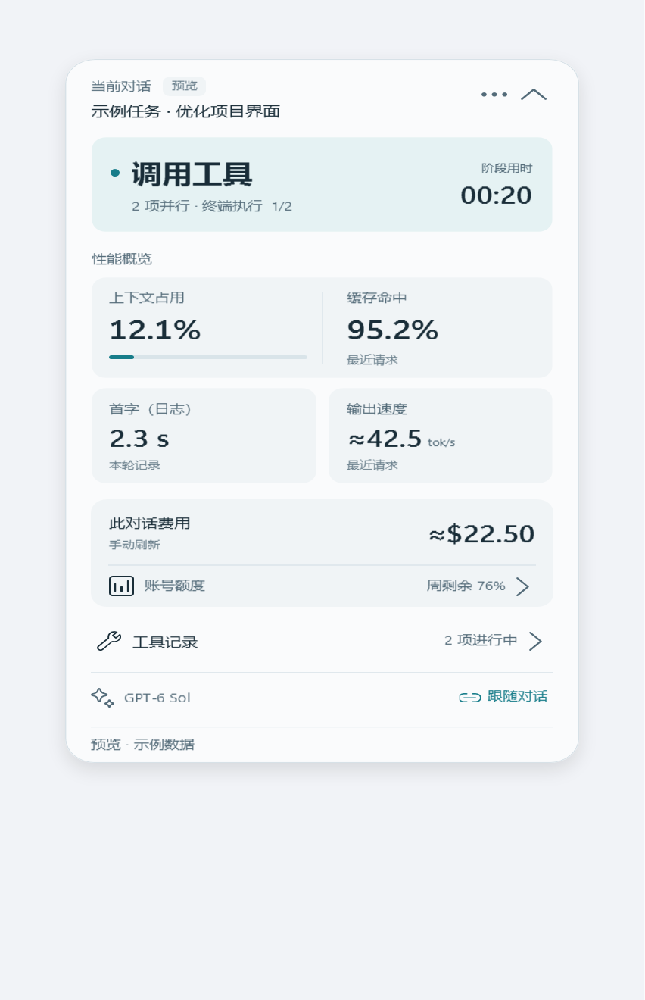
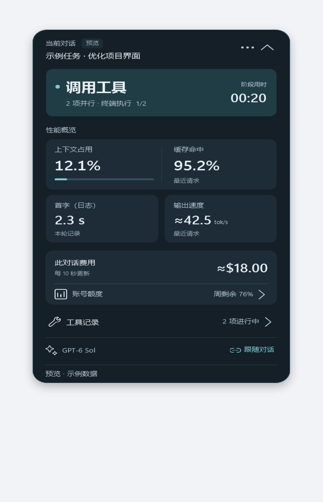
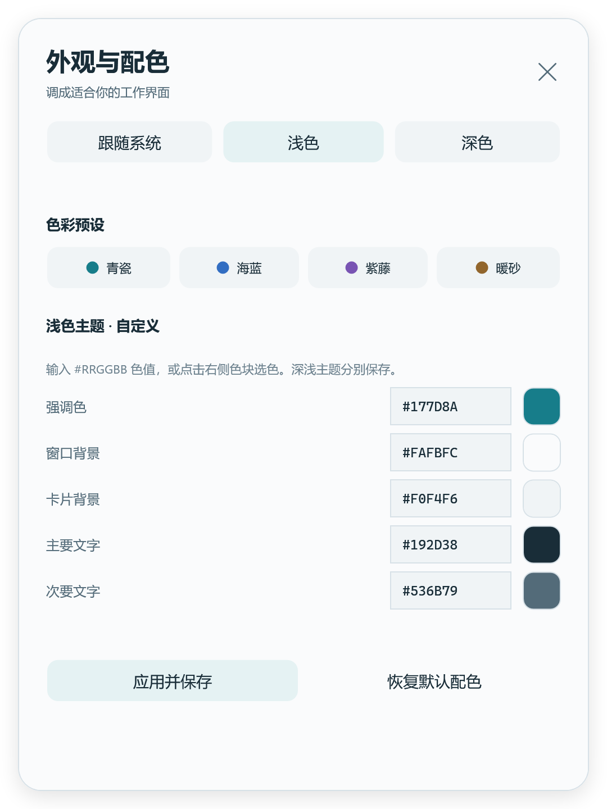
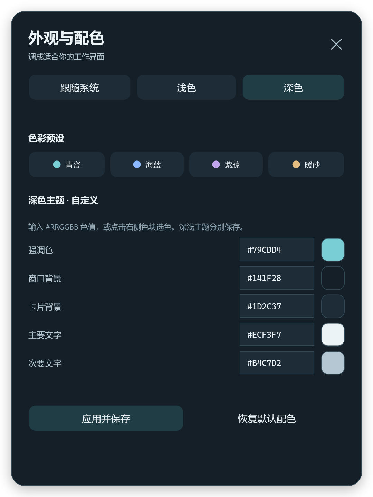
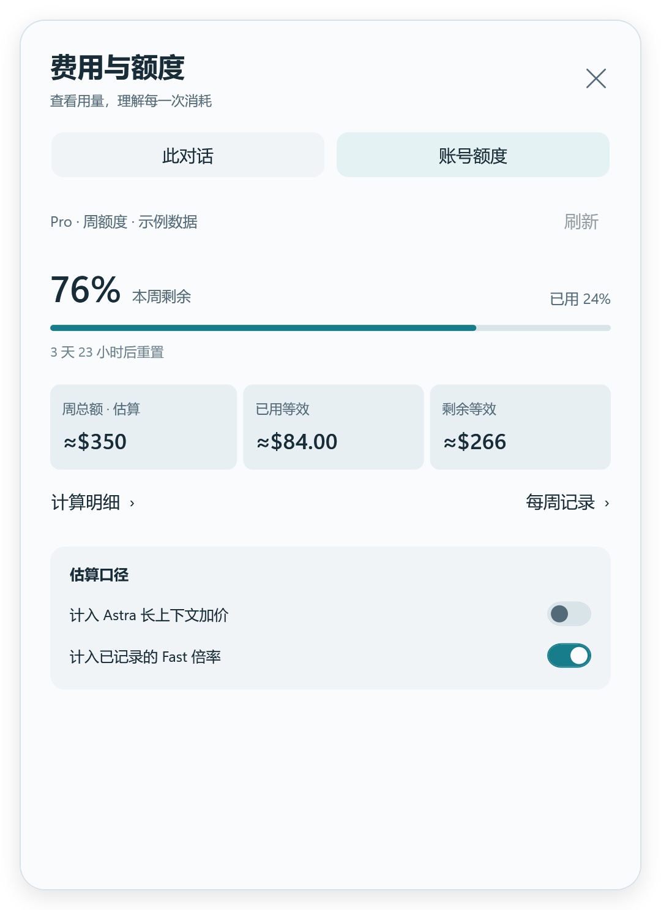
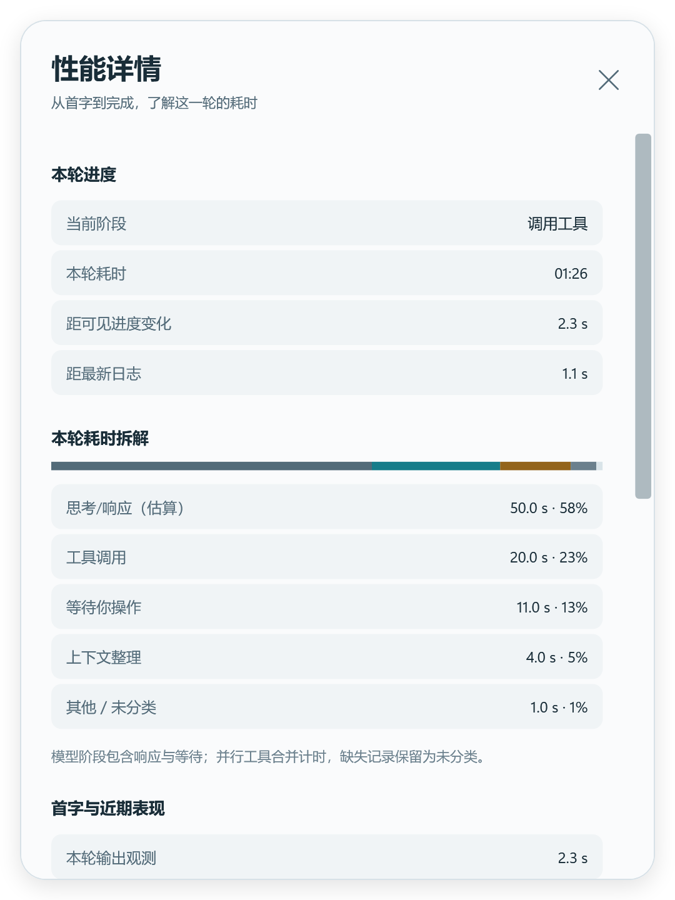
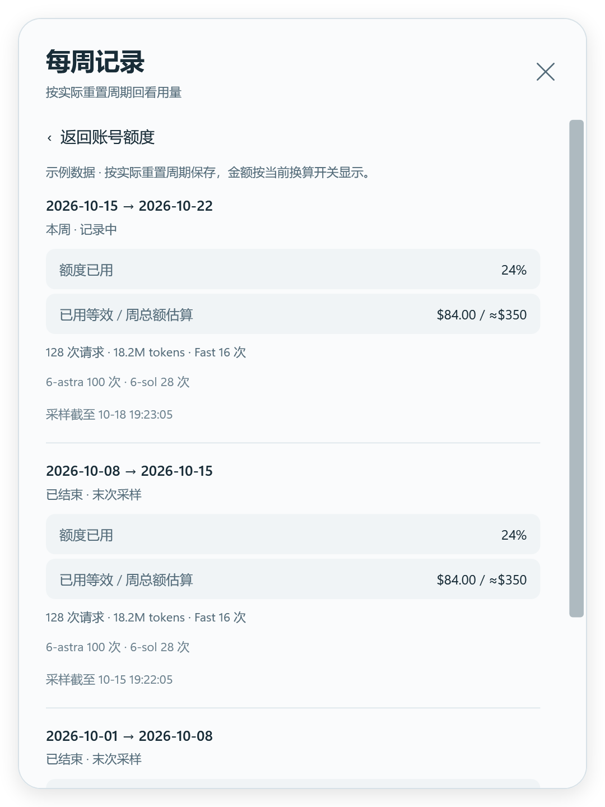

# Codex Enhance

**把 Codex 的状态、性能和费用放在手边。**

一个 Windows 原生状态浮窗。看清当前正在思考、执行工具还是等待操作，随时查看上下文、输出速度和用量；需要时展开，不需要时收起。

[下载发行版](https://github.com/hrx114514x/codex-enhance/releases/latest) · [运行最新源码](#运行最新源码) · [外观与配色](docs/appearance.md) · [反馈问题](https://github.com/hrx114514x/codex-enhance/issues)

<p>
  
  
</p>

*以上及下方均为实际 WPF 界面的示例数据截图。截图对应 v0.5.1，新版 Windows ZIP 已包含界面重构、自定义配色、点击修复，以及新版客户端实时状态与额度读取适配。*

## 一眼看懂当前状态

- **当前阶段**：思考 / 响应、工具执行、等待操作、上下文整理，分别显示阶段计时。
- **性能概览**：上下文占用、缓存命中、首字时间、最近请求输出速度。点击指标进入完整记录。
- **费用与额度**：累计、本轮、今日费用；账号周期、剩余比例、重置倒计时和每周记录。
- **按需诊断**：工具调用、可用性检查、模型来源与耗时拆解。仅 Critical 主动展开。
- **网络与响应**：轻量连接探测、近期超时及模型事件间隔，区分网络线索与工具等待，可随时暂停。

主窗跟随对话，也可以固定观察某个任务。长标题自动截断，空间不足时可滚动；收起后保留紧凑状态条。

## 调成你的配色

右上角 **⋯ → 外观与配色**。

青瓷、海蓝、紫藤、暖砂四组预设，支持跟随系统、浅色和深色。也可以通过取色器或 `#RRGGBB` 色值，自定义强调色、窗口与卡片背景、两级文字颜色。深浅主题分别保存，一键恢复默认。

<p>
  
  
</p>

## 把费用看清楚

“此对话”与“账号额度”分开查看，共用 Astra 长上下文、已记录 Fast 两项计价开关。对话费用默认每 10 秒更新，可关闭自动刷新后手动读取。

<p>
  
  
</p>

金额是**本机模型用量的等效估算，不是实际扣款或官方余额**。对话费用不含子任务、语音及其他设备；缺价或记录不足时明确标注。[查看统计口径](docs/conversation-cost.md)

## 快速开始

### 使用已发布版本

1. 下载 [CodexEnhance-v0.5.1-win-x64.zip](https://github.com/hrx114514x/codex-enhance/releases/download/v0.5.1/CodexEnhance-v0.5.1-win-x64.zip)，完整解压。
2. 确认已安装并登录 Windows Codex 桌面客户端。
3. 双击 **Start Codex.cmd**。

发行包自带运行环境，无需另外安装 Node.js 或 .NET。可选运行 **Install.cmd** 创建桌面快捷方式，或运行 **Preview.cmd** 预览界面。

更新前从托盘退出旧浮窗，设置会保留。如果提示待连接，先保存工作并正常退出 Codex，再通过启动入口打开。启动器不会强行结束正在运行的客户端。

### 运行最新源码

需要 **Windows x64、Node.js 24+ 和 .NET 10 SDK**。采集层只使用 Node 内置模块，无需安装 npm 依赖。

```powershell
git clone https://github.com/hrx114514x/codex-enhance.git
cd codex-enhance
.\scripts\build.ps1
.\scripts\start-codex.ps1
```

仅预览新界面：`.\dist\CodexEnhance.exe --preview`。更多构建、验证及打包方式见 [开发文档](docs/development.md)。

<details>
<summary>更多界面</summary>

<p>
  
  
</p>


</details>

## 数据与兼容性

- 对话数据在本机处理，不上传对话正文，不需要额外 API Key。价格表可从本仓库获取更新；网络监测仅发送不带凭据的轻量请求。
- 主浮窗独立跟随 Codex，不绑定跨进程输入队列；采集命令、退出与诊断写入在后台处理。
- 首字日志、客户端观测和缺失数据分开显示，不用猜测填补未知值。
- 支持 Windows x64 的 Codex 桌面程序包。客户端内部结构变化可能影响实时读取；多窗口和多显示器的覆盖仍有限。
- 发行包目前未签名，提供 SHA-256 校验文件。

这是独立社区项目，与 OpenAI 没有官方关联。

[安装与使用](docs/getting-started.md) · [指标说明](docs/metrics.md) · [外观设置](docs/appearance.md) · [更新记录](CHANGELOG.md) · [第三方许可](THIRD_PARTY_NOTICES.md)
